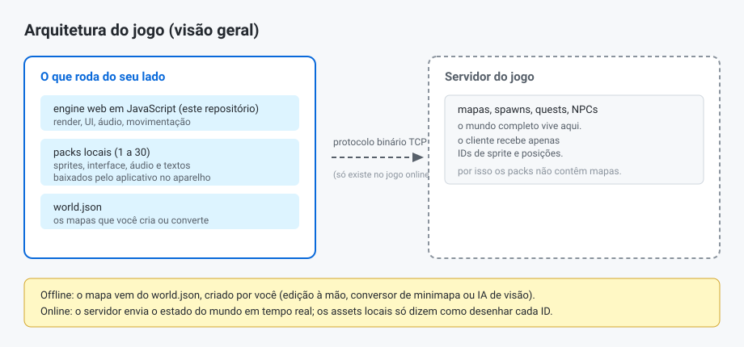
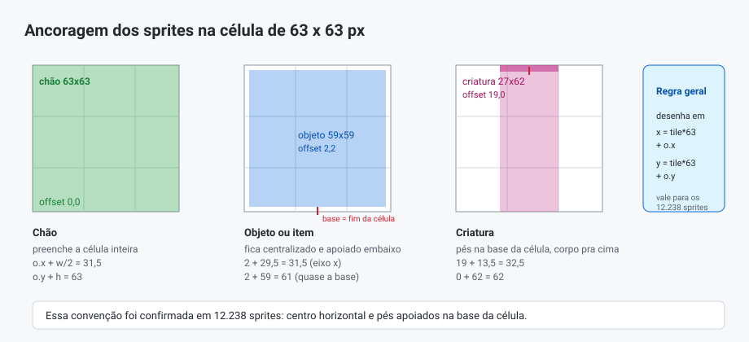
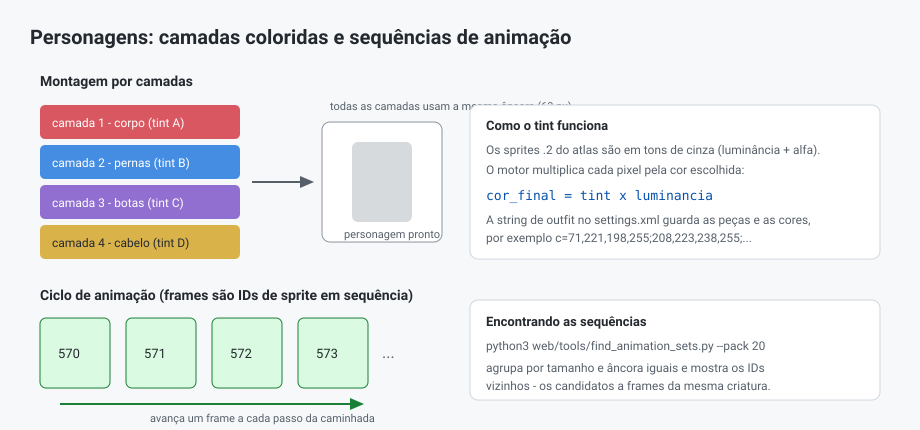
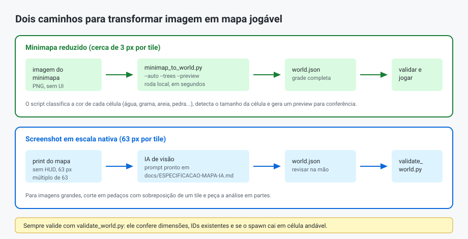

# Eng. Reversa TibiaME 2.49

Anotações, ferramentas e um motor em JavaScript para o **Tibia Micro Edition 2.49**. O jogo oficial guarda sprites, sons e textos numa pasta de dados no aparelho; este repositório documenta o que conseguimos decodificar desses arquivos e entrega um motor que roda direto no navegador, offline, lendo os assets que você já tem instalados.

Aviso: projeto de fins educacionais. Nenhum arquivo do jogo está incluído aqui. Os assets ficam na sua instalação e pertencem aos seus donos; o código e a documentação deste repositório são MIT (veja o [LICENSE](LICENSE)).

## O que tem aqui

| Caminho | Conteúdo |
|---|---|
| `docs/RELATORIO-ARQUITETURA.md` | O relatório principal: formatos de arquivo, atlas, interface, áudio, rede |
| `docs/ESPECIFICACAO-MAPA-IA.md` | Como transformar imagem de mapa em `world.json` (inclusive com IA de visão) |
| `docs/ANIMACOES-E-OUTFITS.md` | O que sabemos sobre personagens, outfits e animações |
| `web/` | O motor completo (PWA) que roda o jogo no navegador |
| `web/tools/` | Ferramentas de linha de comando e o navegador de sprites |

## Como usar

Você precisa da pasta de dados do jogo, aquela com os `pack1`, `pack2` e assim por diante (no Android fica dentro de `Android/data/<pacote do jogo>/files/`).

1. Traga essa pasta para o PC, por exemplo para `MUNDO DE BATALHA/`.
2. Coloque o conteúdo deste repositório ao lado dos packs (as pastas `web/` e `packN/` no mesmo nível) — ou clone o repositório dentro dela.
3. Abra `web/index.html` num duplo clique:
   - no Chrome ou Edge, clique em "Escolher Pasta do Jogo" e aponte para a pasta dos packs;
   - no Brave, Firefox ou Safari, use o botão "modo compatível", que funciona em qualquer navegador.
4. Pronto. Se preferir, ainda dá para servir com `python3 server.py` e abrir `http://localhost:8000/web/`.

Para explorar o acervo visual, abra `web/tools/browser.html` e navegue pelos 12.238 sprites com id, tamanho, offset e modo de cor.

## Por dentro do jogo

### Cliente magro, mundo no servidor

O cliente praticamente não sabe nada sobre mapas. Ele baixa sprites, interface e sons, mas o mundo em si chega pelo servidor em tempo real: a rede envia IDs de sprite e coordenadas, e o cliente só desenha. Por isso os packs não contêm nenhum mapa — e por isso a versão offline depende de mundos criados por nós, no formato `world.json`.



O protocolo é binário sobre TCP; os endereços de login ficam em texto quase puro dentro do `settings.dat`, e o cliente Android é código C++ nativo acessado via JNI (os nomes de arquivo internos aparecem nos próprios logs do jogo, como `TGameViewArea.cpp` e `TPayment.cpp`).

### Sprites: uma grade de 63 por 63

O mundo é desenhado numa grade de células de 63 x 63 pixels. Cada sprite tem um id único e um offset que posiciona o desenho dentro da célula. A convenção, confirmada estatisticamente em todos os 12.238 sprites, é centro horizontal e pés na base da célula.



Os atlas vêm em dois sabores: arquivos `.2` em tons de cinza com transparência (luminância + alfa), usados para partes de personagem que recebem cor em tempo de execução, e arquivos `.4` em RGBA, com a cor pronta. Os XMLs de cada pack (`10.xml`, `20.xml`...) dizem, para cada id, o tamanho, a posição na textura e o offset.

### A interface é declarativa

Em vez de código, as telas são descritas em XML. O `ui_base.xml` (379 KB) junto com as versões `ui_portrait` e `ui_landscape` definem menus, botões, barras, lista de missões e o HUD inteiro através de um sistema próprio de templates, ancoragem e escalonamento 9grid. As imagens vêm em quatro densidades (100, 125, 150 e 175 por cento) e as medidas usam unidades que incluem até milímetros físicos — o joystick virtual, por exemplo, tem 30 mm de diâmetro no código original.

O motor web implementa esse sistema de layout: docking, alinhamento, âncoras, camadas, 9grid e herança de templates, lendo os mesmos atributos dos XMLs originais.

### Som e texto

O áudio é todo declarativo também. O `music.xml` define as ambiências por região (cidade, caverna, deserto, neve...) com canais, prioridades, volumes em faixa, repetições e até blocos aleatórios com probabilidade. O `soundfx.xml` faz o mesmo para os efeitos. Os arquivos são referenciados sem extensão; o cliente procura `.wav`, `.ogg` ou `.mp3`.

Todos os textos da interface vivem em arquivos XLIFF (padrão de tradução) nos seis idiomas do jogo. Os XMLs originais têm até defeitos de formatação que o parser C++ tolera — o nosso motor limpa antes de ler.

### Personagens e animações

Um personagem é montado por camadas de sprites colorizáveis empilhadas na mesma célula, e as cores escolhidas no jogo ficam salvas numa string dentro do `settings.xml`. Quanto à animação: os frames são sequências de IDs de sprite vizinhos. Dá para achar essas sequências com a ferramenta `find_animation_sets.py`, que agrupa sprites de mesmo tamanho e mesma âncora — ela já encontrou ciclos completos, como a sequência 570 a 576 no pack 20.



## Criando mapas

O mundo offline é um arquivo `web/data/world.json` com uma grade de chão, objetos, criaturas e o ponto de nascimento. Há três formas de chegar nele:



Primeira: editar à mão, usando os IDs conhecidos (grama 1, terra 2, areia 4, pedra 6, água 49, caminho 3; árvores 114 a 117; encostas 40; monstros 27, 111 e 112 — o navegador de sprites ajuda a descobrir o resto).

Segunda: converter um minimapa colorido com `minimap_to_world.py`. O script detecta o tamanho da célula, classifica as cores de cada célula, transforma floresta em árvores e gera uma imagem de conferência. Em um minimapa real são dezenas de milhares de células — trabalho para um script local, não para uma IA responder em texto.

Terceira: capturar o mapa em escala nativa (63 pixels por tile) e pedir a conversão para uma IA de visão, usando o prompt pronto em `docs/ESPECIFICACAO-MAPA-IA.md`. Funciona bem em pedaços, com um tile de sobreposição.

Depois de qualquer uma delas, rode a validação:

```bash
python3 web/tools/validate_world.py web/data/world.json
```

O validador confere dimensões, quantidade de linhas e colunas, IDs que não existem nos atlas e se o spawn caiu numa célula andável. Se algo estiver errado, ele aponta a linha exata.

## O motor web

A pasta `web/` contém tudo: o motor (`js/`), os bundles gerados, o service worker, os mapas e as ferramentas. Depois de editar qualquer arquivo em `web/js/`, regenere os bundles com `python3 build-bundle.py` — eles existem porque navegadores bloqueiam módulos ES quando a página é aberta direto do disco.

O motor cobre: atlas e colorização, a interface 9grid com seus layouts, o áudio procedural dos XMLs de som, a interface traduzida, a renderização do mundo com câmera e zoom (100 a 175 por cento), movimentação tile a tile com colisão, caminho automático ao tocar no mapa e joystick virtual com teclado como alternativa.

Ainda falta: animação das criaturas dentro do motor, composição completa de outfits, editor visual de mapas e boa parte dos formulários do `ui_base.xml` (login, vocação, inventário). O roadmap está no fim do relatório.

## Ferramentas

| Ferramenta | Para que serve |
|---|---|
| `web/tools/browser.html` | Navegar e inspecionar todos os sprites |
| `web/tools/minimap_to_world.py` | Minimapa colorido vira `world.json` |
| `web/tools/validate_world.py` | Validar um `world.json` contra os atlas reais |
| `web/tools/find_animation_sets.py` | Descobrir sequências de animação nos sprites |
| `build-bundle.py` | Regerar os bundles do motor |
| `server.py` | Servidor local simples (uso opcional) |

## Documentação completa

- [Relatório de arquitetura](docs/RELATORIO-ARQUITETURA.md)
- [Especificação de mapas](docs/ESPECIFICACAO-MAPA-IA.md)
- [Animações e outfits](docs/ANIMACOES-E-OUTFITS.md)
